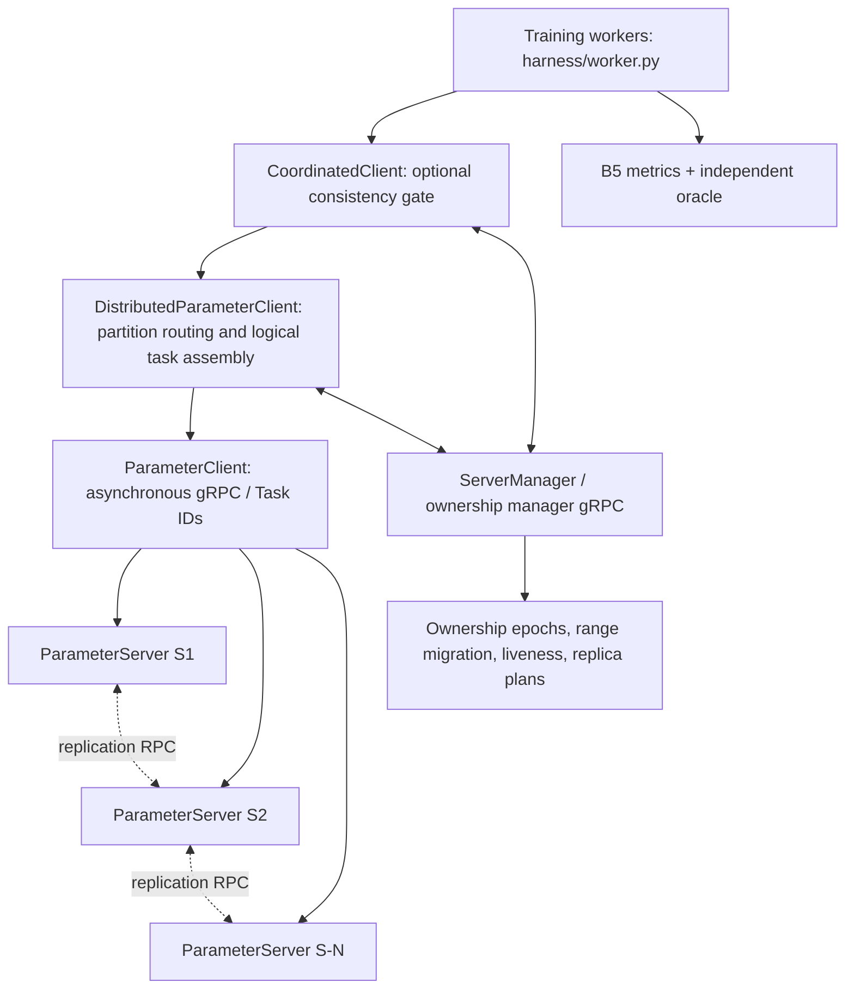

# Architecture and design decisions

This document describes the **implemented** parameter server. The code in `ds/` is the implementation; root-level modules are backward-compatible import aliases and `server.py` remains a CLI launcher.

## Overview



The parameter server stores keyed **float64 vectors**, not model files. Keys are `uint64`, an individual vector has configurable width at least 1, and missing keys read as zero vectors. A default SGD rule applies `w := w - learning_rate * gradient`. Clients can register supported scaled linear update rules remotely. Individual Pushes are staged and committed atomically under the server lock.

### Key modules

| Location | Responsibility |
|---|---|
| `ds/server.py` | Parameter storage, Push/Pull, validation, dependency waits, range migration and replica state |
| `ds/parameter_client.py` | Asynchronous `Task` API, Push/Pull, dependency scheduling, safe retry IDs, value compression |
| `ds/routing.py` | Contiguous half-open partitions covering `[0, 2^64)`, request splitting and Pull merging |
| `ds/distributed_client.py` | Worker-facing multi-server routing and collection into one logical Task |
| `ds/server_manager.py`, `ds/manager_rpc.py` | Ownership map/epochs, dynamic membership, coordination, placement and recovery |
| `ds/range_clocks.py`, `ds/consistency.py`, `ds/coordinated_client.py` | Per-range vector clocks, consistency modes, iteration barriers |
| `ds/value_compression.py` | Reversible float64 payload encoding (zlib transport option) |
| `ds/replica_transport.py`, `ds/failover_controller.py`, `ds/failover_retry.py` | Replica transport, promotion/repair orchestration and client retry |
| `ds/server_heartbeat.py`, `ds/worker_heartbeat.py` | Configurable server and worker liveness reports |
| `harness/` | Reusable deterministic workloads, worker loop, independent oracle and B5 evidence |

## API and execution model

The public standalone worker entrypoint is `ParameterClient`:

```python
from parameter_client import ParameterClient

client = ParameterClient("127.0.0.1:50051", worker_id=101)
try:
    prior = client.pull(range(100, 104))
    weights = prior.wait(timeout_ms=5000).values
    gradients = [1.0, 2.0] * 4
    pushed = client.push(range(100, 104), gradients, width=2, deps=[prior])
    pushed.wait(timeout_ms=5000)
finally:
    client.close()
```

All Push/Pull calls return asynchronous Task handles; `wait(timeout_ms=...)` obtains completion and `done()` checks status. A request may target sparse key lists or compact dense ranges. An individual RPC is limited to a configurable number of **parameter values** (200,000 by default), which prevents huge single-request allocations without capping the total model key count.

Task IDs are `(worker_id, sequence)`. The server hashes the deterministic Protobuf Push payload and recognises identical retries without applying gradients twice. **Workers must use unique stable IDs** and retry an ambiguous operation using its original Task ID and contents. Restarting independent clients with the same ID/sequence is *not* a new worker identity; the Part A diagnostic intentionally demonstrates that collision.

The client schedules local task prerequisites; the server also waits for explicit dependency Task IDs, honours failure states, enforces a deadline, and supports clock requirements. The server cannot guarantee cycle detection across a network of tasks or arbitrary process loss.

## Distribution and ordering

The manager publishes a partition map with an ownership epoch. Each contiguous range has one primary owner. The distributed client partitions sparse lists and dense ranges, sends shard requests and merges replies in original key order. Servers check ownership, reject stale `NOT_OWNER` requests and support map refresh/retry.

**Atomicity boundary:** A single Push to a primary is atomic. An operation touching several primaries is composed of independent shard RPCs, **not** a cross-server transaction or snapshot. This should be stated in the report and demonstration.

The three supported consistency configurations are:
- **Sequential**: coordination gate waits for preceding iteration completion across active workers; X1 additionally uses explicit synchronous round barriers to obtain the textbook analytic contraction formula.
- **Bounded delay**: a configurable positive `τ` allows limited iteration lead; stragglers can still bound effective throughput.
- **Eventual**: workers are not blocked by an iteration-progress gate, permitting greater observed lag.

Range clocks encode per-worker logical progress over coalesced intervals. Updates split intervals only where needed and identical adjacent clocks can merge. These clocks are distinct from the manager's active-worker iteration barrier.

## Communications (Part D)

The implemented optimisations are **reusable sparse key-list IDs (D1)**, **lossless compression of float64 payloads (D2)** and **batching multiple sparse Pull groups (D3)**. Byte measurements are *serialized Protobuf application payloads*, not physical-network or replication traffic. Optimisations can trade CPU/p99 latency against bytes.

## Elasticity and faults (Parts E–F)

E1 range movement uses source snapshots, dirty-key catch-up and a short fenced cutover; graceful remove and dynamic workers are supported. The E4 two-to-four-server under-load demonstration uses **in-process** server objects in its manager transfer flow, not independent networked migration processes. Treat this as a scoped implementation, not a production-grade cross-host rebalancer.

For tested F scenarios, servers heartbeat to a manager, a primary sends ordered replica updates to backup server processes, and successful Push acknowledgement is held until the configured backup has accepted its record. Confirmed primary failure can promote a seeded replica; promotion and reseeding temporarily fence writes. A worker crash may be excluded from consistency barriers, allowing other workers to resume.

**Assumptions/limits:** one confirmed crash-stop failure, manager alive, k=1 for recorded X6; no Byzantine nodes or arbitrary network partitions; no guarantee for multiple simultaneous primary/backup losses. Partial postpublication range migration plus source crash is explicitly **fail-closed**: writes can remain blocked to avoid corruption. Manager state, server weights and replicas are predominantly in-memory; there is no durable replicated consensus protocol.

## Major design alternatives

| Decision | Adopted approach | Alternative and tradeoff |
|---|---|---|
| Partitioning | Central contiguous range ownership map | Consistent hash ring can reduce remapping but complicates contiguous-range workloads |
| Update order | Single-primary atomic commit and replica ACK fence | Cross-shard transactions/consensus improve stronger global semantics but add complexity/latency |
| Clock representation | Coalesced per-range vector clocks | Per-key clocks are simpler conceptually but may grow much faster |
| Consistency | Explicit sequential / bounded / eventual modes | One global barrier simplifies reasoning but sacrifices async throughput |
| Recovery | Confirmed crash-stop promotion + replica repair | Durable consensus log offers stronger availability/safety under partitions, outside tested scope |
| Migration | Snapshot, dirty-catchup, fenced transfer | Fully process-separated online migration is more general but requires a transactional cross-process handoff |

For exact historical design decisions and local test notes, see [the six original Part histories](parts/).
